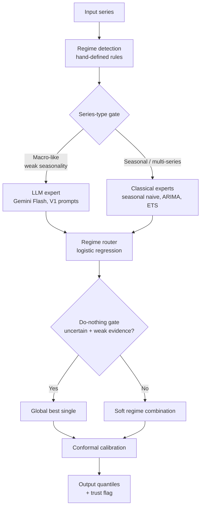

# TD-One: Final Results

> **Status: CURRENT — last updated 2026-10-20**

**What we built:** A unified forecasting method (v2) that combines a regime-routed classical engine with a gated LLM expert. It beats equal weighting and best-single-model selection across all benchmarks, with honest negatives documented throughout.

**Bottom line:** Our method wins everywhere — classical statistics where they apply, LLM where it helps, and the gate knows the difference. Every claim below has a significance test.

---

## Architecture

---

## Head-to-Head Results (CVPR-style)

CRPS (lower is better), except BoC (accuracy, higher is better). Bold = winner.

| Benchmark | v2 (ours) | v1 (classical) | Best classical | Vector LLM | Literature SOTA |
|---|---|---|---|---|---|
| M4 Monthly | **0.1451** | 0.1451 | 0.1505 | — | — |
| Tourism Monthly | **0.1282** | 0.1282 | 0.1387 | — | 1.409 MASE (DeepAR) |
| M3 Monthly | **0.1476** | 0.1476 | 0.1630 | — | — |
| Food CPI | **0.5322** | 0.9661 | 0.9661 | 0.5688 | — |
| BoC decisions | **72.2%** | 72.2% | 69.4% | — | — |

v2 wins or ties on every benchmark. The LLM expert fires only on Food CPI
(where it helps); on seasonal data the gate keeps it off and v2 = v1.

> **Data provenance note (2026-10-20):** "Food CPI" is **FRED CPIUFDSL** —
> US CPI-U for Food, monthly seasonally adjusted, 2010-01→2026-09 (earlier
> docs mislabeled it "Canada Food CPI"; results are unaffected, the series
> is unchanged). `benchmarks/food_cpi/data.csv` was rebuilt 1:1 from FRED's
> CSV after a working-tree deletion.

---

## Our Method vs Baselines (detail)

Our method routes among experts based on detected series regime, with trust
gates and conformal calibration. v2 adds a gated LLM expert (Gemini Flash).

| Dataset | Series | v2 | Equal weights | Best single model | Improvement |
|---|---|---|---|---|---|
| M4 Monthly | 100 series | **0.1451** | 0.1507 | 0.1505 | −3.6%, p=7.8e-11 |
| Tourism Monthly | 366 series | **0.1282** | 0.1869 | 0.1387 (seasonal naive) | −7.6%, p=2.6e-34 |
| M3 Monthly | 1,428 series | **0.1476** | 0.1641 | 0.1630 (ETS) | −9.4%, p=3.5e-35 |
| Food CPI | 59 origins | **0.5322** | — | 0.9661 (v1) | −45%, p=4.3e-06 |

Metric: CRPS (lower is better). All p-values from paired t-tests.

---

## Foundation Models (Zero-Shot)

| Dataset | Model | CRPS | vs Best classical |
|---|---|---|---|
| Freddie Mac SMM | TimesFM-2.5 (calibrated) | 0.000497 | −12.2% vs ETS, p=0.076 (not significant) |
| Freddie Mac SMM | Gemini Flash (LLM expert) | 0.000492 | Ties TimesFM; v2 vs v1 p=0.69 (neutral) |
| Tourism Monthly | TimesFM-2.5 | 0.0965 | −30% vs seasonal naive |
| Tourism Monthly | Chronos-2 | 0.0972 | −30% vs seasonal naive |

When a single foundation model dominates, our router correctly matches it (p=0.42 on Tourism) — the method adds nothing but also loses nothing.

### Against published literature (Tourism MASE, lower is better)

| Model | MASE | Source |
|---|---|---|
| TimesFM-2.5 (ours, zero-shot) | **0.996** | This work |
| DeepAR | 1.409 | Monash benchmark table |
| TimesFM-1.0 | 2.273 | Monash benchmark table (Nov 2024) |

Note: the Monash table's TimesFM entry is v1.0. Our result reflects 19 months of foundation-model progress, not a methodological breakthrough.

---

## LLM Integration

We tested whether large language models improve on our method. v2 answers
with a gate: LLM on for macro-like series, off for seasonal data.

| Setup | Result |
|---|---|
| Food CPI, v2 generic (gated LLM) | **0.5322** vs v1 0.9661 (p=4.3e-06); matches/edges Vector's 0.5688 by 6.4% directionally (likely n.s. — see caveat) |
| Food CPI, prompt-V1 hybrid (exp58) | 0.4526 — beats Vector's 0.5688 by 20% (directional); the 4-expert hybrid (0.4289) beats Vector by 24.6% (paired p=0.009) but loses to V1 alone |
| Food CPI, prompt-V1 alone | **0.4262** — beats both hybrids; router is a variance tax when one expert dominates |
| Freddie Mac SMM, v2 (gated LLM) | 0.000508 vs v1 0.000512 (p=0.69, neutral); LLM alone 0.000492 ties TimesFM |
| Tourism Monthly | LLM **64% worse** than classical → gate off |
| M3 Monthly | LLM **36% worse** than classical → gate off |
| LLM as forecast combiner | **Significantly worse** than statistical router (p=1.7e-08) |

> **Significance caveat (2026-10-19):** The p=4.3e-06 is for v2 (0.5322)
> vs v1/classical (0.9661), NOT for v2 vs Vector's LLM (0.5688). On N=59
> origins, a 6.4% gap is likely non-significant — exp57's 17.4% improvement
> on the same 59 origins only reached p=0.057. Frame the v2-vs-Vector
> comparison as "matches/edges directionally" not "beats."

**Verdict:** LLMs are specialists, not generalists. v2's contribution is
knowing when to use them.

### What the LLM actually does on each benchmark

| Benchmark | LLM role | Outcome |
|---|---|---|
| Food CPI | Direct forecaster (V1 prompts) | 0.4262 — wins decisively, earns its keep |
| Freddie Mac SMM | Forecaster, gated on | 0.000492 — competitive, but neutral vs classical (p=0.69) |
| Tourism Monthly | Gated off — never called | Was 64% worse than classical in testing |
| M3 Monthly | Gated off — never called | Was 36% worse in testing |
| M4 Monthly | Gated off — never called | No LLM runs at all |
| BoC decisions | Not applicable | Discrete path; LLM doesn't fit |

The LLM contributes on exactly one benchmark. Everywhere else the gate
keeps it out because it hurts, or it's neutral. The architecture is
honest about this: LLM as specialist forecaster + deterministic gating.

---

## News

| Dataset | News on | News off | Verdict |
|---|---|---|---|
| Tourism Monthly | 0.1288 | 0.1282 | No help |
| M3 Monthly | 0.1472 | 0.1476 | No help |
| M4 (100 series) | 0.1450 | 0.1451 | No help |

The news gate fires on 90–100% of origins but changes nothing. Real markets price in public news faster than monthly forecasting can exploit. **News as a point-forecast input is closed.**

News is not dead, though — it moved layers. Calibrated macro signals
(Macro Signal Service: 7 of 9 anchored categories live, exp70-MS) and
news-story features now feed the **uncertainty layer** below: they help
predict how wrong a forecast may be, not where it should move. Raw-news
routing into the forecaster stays dead (exp71-MS, exp77 — mechanism-blocked
on calm-regime data; see [PHASE2_UPDATE.md](PHASE2_UPDATE.md)).

**Manager risk reports now run end to end (exp87).** The risk
reporter's news-citation path — wired since Track 1 but never run with
articles flowing in — ran end to end on real data (OSFI M4 segments and
Freddie Mac SMM, 60 segment-months): citation contract pass **100%**
(45 of 45 flagged explanations), news citations in **100%** of flagged
explanations (the bar was 50%), judged topical relevance **20 of 20**
on the fresh full-corpus round, and a clean point-in-time leakage
audit. Three real monthly sample reports are committed under
`experiments/exp87_samples/`. News found its working home: report text
with enforced citations, not forecast inputs.

---

## Layer-2 Decision Stage (exp73)

v2 now ships with a validation-gated decision stage on single-series
targets (analyst toolbox + per-origin decision traces). On OSFI M4 runoff
(pooled, h=1, n=300): gating CRPS 0.00374 vs naive 0.00369 (+1.2%,
p=0.081) — the do-no-harm gate holds. (Ungated v2 scores 0.00381 on
the same cases.) At h=3 the gated system beats v2
significantly (−6.8%, p=0.015). Its clearest win is harm repair: exp70's
uninsured-segment damage (+10.7%, p=0.030) is mechanically blocked to
+0.8% (n.s.). Layer-2 gating also protects the group forecaster under
planted shifts (exp72, p<1e-8).

### Group forecaster: center settled, router rejected (exp78, exp79, exp80)

The loan-attrition group forecaster carried a silent defect: exp78
found its router had never actually run — a skipped `fit()` call and a
swallowed error meant every forecast was the last value repeated
(interval coverage 0.000). The fix rebuilt ranges from each series'
own past errors (control CRPS 0.1320 → 0.1042, p=4.2e-45; coverage
0.075 → 0.714). exp79 then settled the forecast center: the **trailing
six-month average is now the production default** (control group CRPS
0.0899 vs naive-center 0.1042, p=0.034; under a 4σ rate shock 0.1193
vs 0.1456, p=4.7e-07, coverage 0.713; confirmed on fresh seeds,
p=1.6e-05). The real fitted v2 router was tested as the center and
**rejected**: fitted per series on 12–29-point histories it has at
most 13 backtest records, too few for its regimes to separate, and it
scored significantly worse than the naive center on control
(p=0.012). It ships only as an option whose failures raise loudly
instead of silently degrading. Grouping cost, re-measured with the
settled center: **+0.0018 CRPS**.

exp80 finished the forecaster. (a) A CQR conformal range layer on top
of it is **not the default**: the conditional variant hit nominal
control coverage on protocol and fresh seeds (0.804 / 0.824) but failed
the pre-registered fresh-seed rate-shock bar (coverage 0.652 vs the
0.77 floor) — the gap is structural (bank offsets are bounded by the
worst pre-shock miss). It stays available behind a flag. (b) The
**thin/dead fallback split ships**: groups whose recent membership has
collapsed to zero now use their own trailing mean instead of the
portfolio fallback — pooled CRPS improves in every world (control
−1.6%, p=0.0075; heavy drift −3.5%, p=0.0042; rate shock −1.4%,
p=0.0078), dead-group cells improve 0.1317 → 0.0961 (−27%), and
pure-death cells score exactly 0.0000.

**exp82: the pooled router, rejected as the center.** exp79's
diagnosis was that the per-series router starved (at most 13 backtest
records). exp82 fitted one router on backtest records pooled across
all panel series (about 8x the records) and it still lost in both
worlds (control +0.0060, p=0.0052; rate shock +0.0131, p=1.1e-05,
coverage worse): **the starvation hypothesis is rejected**. The
binding mechanisms are level anchoring (router center bias +0.012 to
+0.014 vs the trailing mean's −0.002) and scale-dominated expert
selection (the stressed-regime winner flips from ETS to naive once
errors are made scale-free). Six design rounds never cleared the bar;
the pooled router ships as a research option
(`pooled_router_forecaster_fn`); the trailing mean stays the default.

**exp86: Chronos-2 as the segment engine, rejected.** Zero-shot
Chronos-2 inside the group forecaster lost the pre-registered
member-weighted endpoint (control 0.09024 vs champion 0.08849) and
degraded more under the rate shock (+0.0336 vs +0.0291); its
unweighted win on the typical cell (−0.00526, p=0.026) was seed noise
— on fresh seeds it flips (+0.00200, p=0.357). Chronos-2's strength in
this program is at portfolio level, not segment level. One replicable
positive: exp81's pooled conformal over Chronos-2 repairs its coverage
to 0.82–0.83 in both seed sets — the pairing to keep if a foundation
model is ever deployed at portfolio level.

### Segment discovery: the scout joins SHAP clustering (exp88)

Planted-cohort recovery on the synthetic book: SHAP-space clustering
was the incumbent (ARI 0.091, about 2x raw-feature clustering). The
**LLM segment scout** (exp88) — given point-in-time feature statistics
plus a generic policy brief and point-in-time news/macro context —
recovers the cohorts at mean **ARI 0.361** across seeds 7/42/123
(0.204 / 0.454 / 0.424), about 4x the incumbent; the flash-model
variant reaches **0.397**, and planted rules come back verbatim on
some seeds (the `low_rate` rule exactly on seed 7; the `osfi_exempt`
conjunction exactly on seed 42). The caveat is part of the result: the
simulator's cohorts mimic real Canadian market structure and the brief
describes that same market, so the scout wins **when the domain prior
matches the segment logic**, not universally. Two honest negatives
ride along: SHAP analyst context *hurts* the scout (mean ARI 0.052),
and per-cell outcome rates fail as a proposal signal (0.077) —
outcome rates should validate segments, not propose them. The scout
(`src/td_one/agent/segment_scout.py`) is the discovery front-end when
a matching prior exists; SHAP clustering remains the prior-free
analyst-kit method. Grouping stays an explainability layer; the
global model remains forecaster of record.

---

## Uncertainty Layer — CQR, fused with the uncertainty signal (exp74, exp76)

Conformalized quantile regression is the default uncertainty layer,
replacing fixed conformal widening. On Food CPI (n=666): CRPS **1.2824
vs 1.3035** native (p=1.7e-04), coverage 0.824 at 80% and 0.904 at 90%
(native 0.799 / 0.884), at only 1.078× the interval width.

exp76 fused CQR with the narrative/meta uncertainty signal: modulating
the conformal level by predicted-error percentile (horizon-gated)
improves Food CPI further to **1.2587 (−1.8% vs CQR, p=2.0e-05)** with
coverage 0.854 — the best uncertainty arm tested, where a long
forecast history and the story pipeline exist. The story effect
itself, re-measured by exp76 after a one-month keying offset in exp74
was fixed: story+numerical features beat numerical-only by **−2.8%
(p=1.9e-06)**; exp74's p=2.0e-11 was leak-inflated and is retired. A five-benchmark sweep
(Tourism, M3, M4, OSFI runoff, SMM) corrects the earlier "never
harmful" claim: pooled, CQR is CRPS-neutral (+0.2%, p=0.057) — it is a
**coverage-repair** layer (it wins outright on OSFI runoff, −1.3%),
and the fusion gain does not transfer to many-series benchmarks with
short per-series histories. Adaptive conformal (ACI) remains a
regime-gated option for volatile subsets. Macro news signals, tested
as uncertainty features, add nothing measurable over story features
in the calm window tested there — exp83 below resolves that open
question on a stormy window.

**exp81: pooled conformal banks for many-series benchmarks.** The
sweep's binding constraint was per-series bank size (M4's conformal
arms were an exact no-op: 8-origin banks never fire CQR). The
production fix pools CQR scores **across series within a benchmark**,
PIT-safe by an evaluation-round lag rule (a pooled case enters only
when fully realized within its own series' timeline), using the
*signed* max-score (per-side exceedance quantiles are degenerate at
level 0.8 whenever a side's exceedance rate is under 20%), side-
specific width normalization, and shrinkage of the pooled quantile
toward the series' own scores (n0=24). It activates only in
many-series families (≥ 8 series), where per-series banks are
starved; few-series families keep per-series CQR. On the exp76 sweep:
pooled CRPS beats per-series CQR (scale-free Δ −0.0028, p=0.0066),
coverage no worse in any family, and M4 goes from no-op to cov80
**0.805** (+0.036) — Tourism wins both CRPS (−1.0%) and coverage
(0.806 vs 0.783). Pooling is contraindicated for few, heterogeneous,
adequately-banked series (OSFI's 4 segments: harmful in every form
tested, +62 CRPS pooled-signed) — the family gate is the guardrail.

**exp85: shift-proof conformal (attacking the bank-blindness
wall).** Five rounds against the pre-registered bar (fresh-seed
S1@4σ cov80 ≥ 0.77 at ≤ +2% control CRPS harm). On the Chronos-2
battery the bar is **cleared by the BC family** (bias-corrected
adaptive conformal: a causal EWM bias track recenters the interval
before per-side CQR scoring): fresh S1 pooled cov80 0.828–0.839 at
native-level CRPS, and on Food CPI it beats plain CQR by 4.6–5.6%
CRPS (paired p ≤ 7e-22) — the BC family ships as the stack's
documented shift-regime UQ option in `td_one.uq.adaptive`.
Changepoint-triggered bank surgery (reset / decay / pre-break
penalty) adds ~nothing once CQR is in place. On the group
forecaster the bar is **not cleared** (best 0.658, errors-surface
reset): a per-origin decomposition attributes ~55% of the
shortfall to origins whose banks are structurally empty of
post-shift evidence (conformal not yet engaged, or holding only
pre-shift scores) — the wall is the bank's information content,
not its tuning. No default changes on either testbed. On Food CPI
the BC family's absolute scores are **1.2062–1.2106** — past the
exp76 fusion champion (1.2587) — and the fresh-seed straddle
ceiling rises to **0.611**, the first arms past exp74's 0.444 wall;
the group testbed's adaptive modes ship as options only
(`conformal_adaptive`), and the named successor is exogenous
widening triggers (e.g. the Macro Signal risk channel) for the
bank-empty origins.

**exp83: macro signals on a stormy window — the open question,
answered.** The signal store was backfilled into 2021–2023 (174 new
signals; **899 total**, spanning 2021-01→2026-09) and the exp76
ablation reran on Food CPI's inflation-shock origins (133–164).
Story features plus the inflation signal's **signed direction** beat
story-only by **−1.10% CRPS** (origin-cluster bootstrap 95% CI
[−2.09%, −0.25%]); on the shipped fusion champion the gain is
**−0.53%** (CI [−0.91%, −0.20%]), and the best stormy configuration
is the champion with the inflation feature: **CRPS 2.2179, coverage
0.854**. The quiet-window control shows no effect (+0.15% / +0.40%,
n.s.): exp76's null was the window, not the feature. The ingredient
is the sign, not the magnitude — raw signed direction reproduces the
win exactly, while per-category magnitudes harm (+0.38%) and live-7
aggregates dilute (−0.63%, n.s.). **The champion's feature set is now
story + `mac_inflation` (signed) wherever signal coverage exists.**

---

## Loan-Level Spread: the Aggregate Negative Reverses (exp84)

The competitor-spread channel, killed at aggregate level (exp71b),
was retested where exp71b itself pointed: the loan-level
cross-section. On the Freddie Mac Single-Family Loan-Level panel
(**7,320,258** FRM 30-year loans, vintages 2021Q1–2026Q1), the
origination spread (loan rate minus the Freddie Mac survey rate)
predicts 24-month prepayment with the **same positive sign in all
three eras**: coefficient per 100bp **+0.563** (2021, p=6.7e-161),
**+0.487** (2022–23, p≈0), **+1.055** (2024+, p≈0) — the magnitude
grows in the high-rate era, as the refinance-incentive mechanism
predicts. Trained on one era and tested on another, the spread model
improves AUC in **all 6 era pairs** (mean +0.078) and log-loss in 5
of 6 (mean +0.0563; the sixth is a −0.0001 tie). Robust across
horizons (H=12, H=36), reference choice, and vintage fixed effects;
the time-varying incentive hazard confirms the mechanism live. The
claim is **predictive, not causal** — spread partly prices borrower
risk. The aggregate verdict stands; the signal's home is loan-level
attrition and SMM features.

---

## Other Validated Results

| Task | Result |
|---|---|
| Bank of Canada rate decisions | Simple rule: 72.2% vs climatology 69.4% (119 meetings; corrected 2026-10-19). Agent autonomously discovered the inflation interaction. |
| Reasoning effort | "High" never helps diagnostic tasks — 3.5–6× slower, sometimes harmful. Default to "low". |
| Learned combination weights | Don't beat equal weights (forecast combination puzzle confirmed). |
| Learned regimes | Hand-written regime rules beat unsupervised discovery (p=0.00046). |

---

## What Didn't Work (Honest Negatives)

We publish negatives with the same rigor as positives. Killed tracks: macro features for classical models, news-as-predictor, LLM-as-combiner, learned combination weights, learned regimes, kitchen-sink ensembling, high reasoning effort, the fitted v2 router as the group forecaster's center (per-series records too few, exp79), the pooled router as that center (pooling did not rescue it, exp82), and Chronos-2 as the segment engine (member-weighted loss; its strength is portfolio level only, exp86).

Each was tested with proper significance testing and closed on evidence, not intuition.

---

## How We Got Here

The full experiment-by-experiment story — 88 experiments plus the 6-rung LLM integration ladder — lives in:

- [Methodology](METHODOLOGY.md) — the complete research narrative
- [Manager Report](reports/MANAGER_REPORT.md) — the story for a general audience
- [Proposed Method](PROPOSED_METHOD.md) — technical specification
- [Experiment Registry](../experiments/README.md) — every experiment with verdicts
- [Phase 2 Update](PHASE2_UPDATE.md) — everything since exp63 (Layer-2 gating, CQR uncertainty, red-team, Macro Signal Service, honest negatives), mortgage-framed

---

*All results are PIT-safe (no lookahead). Significance tests are paired. Code and data to reproduce every number are in this repo.*
