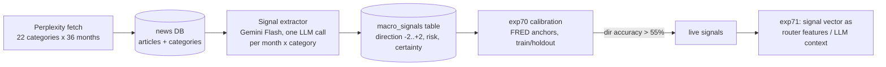

# Macro Signal Service

A dedicated news-reading LLM that produces **calibrated categorical macro
signals**, reusable across benchmarks — a signal store, not a forecast-time
news feed.

## Why this exists

Feeding raw news at forecast time was an honest negative twice over
(exp44 synthetic-only positive, exp46 real-data wash). The hypothesis
here is different: **precompute** the synthesis once per month, **validate**
the signals against realized data on training periods, and only then let
downstream models consume them.

## Architecture

## The signal

For each `(month, category)`:

| Field | Meaning |
|---|---|
| `direction` | Integer -2..+2 per the per-category rubric in `macro_signal.py` |
| `risk` | `low` / `med` / `high` — macro risk to household finances |
| `certainty` | 0..1 — LLM confidence (few/contradictory headlines => low) |
| `summary` | 1-2 sentences citing article titles |

## PIT safety

- The signal for month M uses **only** articles with `pub_date` in M.
- Forecasts at origin O consume `signals_asof(O)` — months `<= O` only.
- Calibration uses training months only; holdout is reported, never gated on.

## Phases

1. **Fetch** (`scripts/fetch_macro_signal_news.py`): 22 categories x 36 months via Perplexity, resume-safe, budgeted. Coverage report below is honest — empty cells stay empty.
2. **Extract** (`scripts/run_macro_signal_extraction.py`): Gemini Flash via the Vector proxy, resume-safe.
3. **Calibrate** (`experiments/exp70_macro_signal_calibration.py`): FRED anchors, pre-registered gate (>55% directional accuracy on train), holdout reported.
   - **Kill criteria are tripwires, not executions.** A failed gate produces a diagnosis (noisy / mistimed / miscalibrated / thin / anti-correlated) and tries principled variants. A category that passes on a variant goes `LIVE(variant)` with the variant recorded.
   - **Enforced iteration rule (Vandad 2026-10-19):** diagnose → improve → reiterate for 4–5 rounds before anything is called dead. exp70 runs 5 rounds per category (base → timing offsets → certainty-weighting → strong-only → 2-month smoothing) and logs what each round taught. exp71 does the same for integration (base encoding → certainty-weighted encoding → lead-1 timing → news_weight search → drop-one-category ablation). The iteration log ships with the results.
4. **Integrate** (exp71): live categories only, CRPS vs no-signal on SMM, paired test. Same philosophy: if it doesn't beat baseline, diagnose (wrong aggregation? wrong timing? wrong feature encoding?) and try one alternative before concluding.

## Coverage (Phase 1 — in progress)

*Table fills when the fetch completes.*

## Calibration results (Phase 3 — pending)

*exp70_macro_signal_results.json lands here.*

## Integration verdict (Phase 4 — pending)
