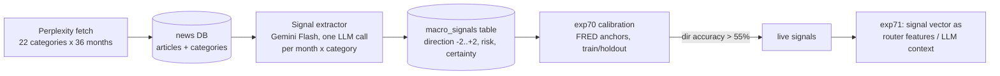

# Macro Signal Service

> **Status: CURRENT — last updated 2026-10-20**

A dedicated news-reading LLM that produces **calibrated categorical macro
signals**, reusable across benchmarks — a signal store, not a forecast-time
news feed.

## Why this exists

Feeding raw news at forecast time was an honest negative twice over
(exp44 synthetic-only positive, exp46 real-data wash). The hypothesis
here is different: **precompute** the synthesis once per month, **validate**
the signals against realized data on training periods, and only then let
downstream models consume them.

## Architecture

## The signal

For each `(month, category)`:

| Field | Meaning |
|---|---|
| `direction` | Integer -2..+2 per the per-category rubric in `macro_signal.py` |
| `risk` | `low` / `med` / `high` — macro risk to household finances |
| `certainty` | 0..1 — LLM confidence (few/contradictory headlines => low) |
| `summary` | 1-2 sentences citing article titles |

## PIT safety

- The signal for month M uses **only** articles with `pub_date` in M.
- Forecasts at origin O consume `signals_asof(O)` — months `<= O` only.
- Calibration uses training months only; holdout is reported, never gated on.

## Phases

1. **Fetch** (`scripts/fetch_macro_signal_news.py`): 22 categories x 36 months via Perplexity, resume-safe, budgeted. Coverage report below is honest — empty cells stay empty.
2. **Extract** (`scripts/run_macro_signal_extraction.py`): Gemini Flash via the Vector proxy, resume-safe.
3. **Calibrate** (`experiments/exp70_macro_signal_calibration.py`): FRED anchors, pre-registered gate (>55% directional accuracy on train), holdout reported.
   - **Kill criteria are tripwires, not executions.** A failed gate produces a diagnosis (noisy / mistimed / miscalibrated / thin / anti-correlated) and tries principled variants. A category that passes on a variant goes `LIVE(variant)` with the variant recorded.
   - **Enforced iteration rule (Vandad 2026-10-19):** diagnose → improve → reiterate for 4–5 rounds before anything is called dead. exp70 runs 5 rounds per category (base → timing offsets → certainty-weighting → strong-only → 2-month smoothing) and logs what each round taught. exp71 does the same for integration (base encoding → certainty-weighted encoding → lead-1 timing → news_weight search → drop-one-category ablation). The iteration log ships with the results.
4. **Integrate** (exp71): live categories only, CRPS vs no-signal on SMM, paired test. Same philosophy: if it doesn't beat baseline, diagnose (wrong aggregation? wrong timing? wrong feature encoding?) and try one alternative before concluding.

## Results (2026-10-20)

- **exp70 calibration:** 7/9 anchored categories live over 5 rounds (fx corr +0.63 holdout 0.79; food_prices holdout 0.82; inflation rescued-by-timing R2=0.93; wars_geopolitics via smoothing; services_costs via strong-only). Dead: basic_needs (anti-correlated, sign-inversion hypothesis recorded not applied), central_bank_rates (structurally silent, n=1). 13 categories unanchored. Certainty does not calibrate. Full table: [exp70 report](exp70_macro_signal_report.md).
- **exp71 SMM integration:** ❌ honest negative — 7 rounds all NEGLIGIBLE (effect ~1e-7 CRPS; effect-size floor ≥1% enforced). Diagnosis: signal dilution (mean |stress| 0.167) + a structural block — all 28 SMM origins in the signal window label 'calm' (stressed months were 2022, pre-coverage), so the router is degenerate and both regime experts collapse to one model. The signal store itself is live; Food CPI integration is the open next test. Full log: [exp71 report](exp71_macro_signal_report.md).
- **exp77 Food CPI integration:** ❌ honest negative — the same structural block: all 33 signal-window origins (2023-11..2026-07) label 'calm', the v1/v2 router is degenerate in all 5 folds, and both regime experts collapse to the LLM expert, so the modulation moves probability mass between identical experts (CRPS diff ~1e-16, all arms). 6 diagnostic rounds (live-minus-food_prices, per-category learned features, holdout-window-only, drop-one) all null; reproduction of exp64 bit-exact (0.5321591). The engine hypothesis (Food CPI spans non-degenerate regimes) is refuted — the calibration question itself remains *untested*, not refuted: no signal can move a forecast through this router on a uniformly calm window. Full log: [exp77 report](../experiments/exp77_report.md).
- **exp83 uncertainty-feature test on a stormy window:** ✅ **the exp76 S8 question resolved positively.** The store was backfilled into 2021-01→2023-09 (live-7; 174 signals, 193/231 cells, $2.88 Perplexity spend) and exp76's S8 protocol rerun on Food CPI's inflation-shock origins (133–164): the designated encoding (story + standalone inflation direction) beats story-only by −1.10% CRPS (origin-cluster bootstrap 95% CI [−2.09%, −0.25%]) in the meta family and −0.53% [−0.91%, −0.20%] in the shipped F1 h3-gated champion; the same-run quiet-window control is null. exp76's null was the window, not the feature. The champion's feature set is now story + `mac_inflation` where coverage exists. Full log: [exp83 report](../experiments/exp83_report.md).

## Coverage (Phase 1 — complete)

792 cells fetched (22 categories × 36 months 2023-10..2026-09); 725 signals extracted (67 zero-article cells). Coverage honestly below the ~20/month target — category means: wars 8.0, markets 7.6, central_bank_rates/fx/elections 6.3, pandemics 6.2, ai_startups 6.1, global_trade 5.6, immigration 4.8, small_business 4.5, services 4.3, inflation/school 4.2, basic_needs 4.1, flights 3.9, minimum_wage 3.7, car 3.2, income_tax 3.0, housing 2.8, labour 2.7, food 2.1, salary_region 1.7 (22 zero-months — thinnest).

**Backfill (exp83, 2026-10-20):** the store was extended backwards into 2021-01..2023-09 for the 7 live categories only (the inflation-shock window exp76's S8 ablation needed): 193/231 cells fetched (300 Perplexity searches, est. $2.88, the experiment's hard cap), 174 signals extracted — inflation complete 33/33; per-origin availability at the test origins 0.84–1.00 with median staleness 0. The store now totals 899 signals spanning 2021-01→2026-09.

## Calibration results (Phase 3 — complete)

See Results above and [exp70 report](exp70_macro_signal_report.md); data in `exp70_macro_signal_results.json`.

## Integration verdict (Phase 4 — complete)

❌ honest negative on **both** integration targets tested (mechanism-blocked); signal store stays a live research artifact. SMM (exp71-MS): dilution + single-regime window. Food CPI (exp77): all 33 signal-window origins label 'calm', router degenerate, experts collapse — the calibration question remains untested because the channel is closed on uniformly calm windows. See Results above and [exp71 report](exp71_macro_signal_report.md) / [exp77 report](../experiments/exp77_report.md). Recommended next use: the calibrated signal vector as an *uncertainty* feature (exp74/exp76 line), where narrative features are already proven to carry signal.

**Update (exp83, 2026-10-20):** that recommended use is now tested and **positive** — as an uncertainty feature on a volatile window, the standalone inflation signal improves both the meta arm and the shipped F1 champion (CIs excluding zero; quiet control null). See the exp83 bullet under Results.
