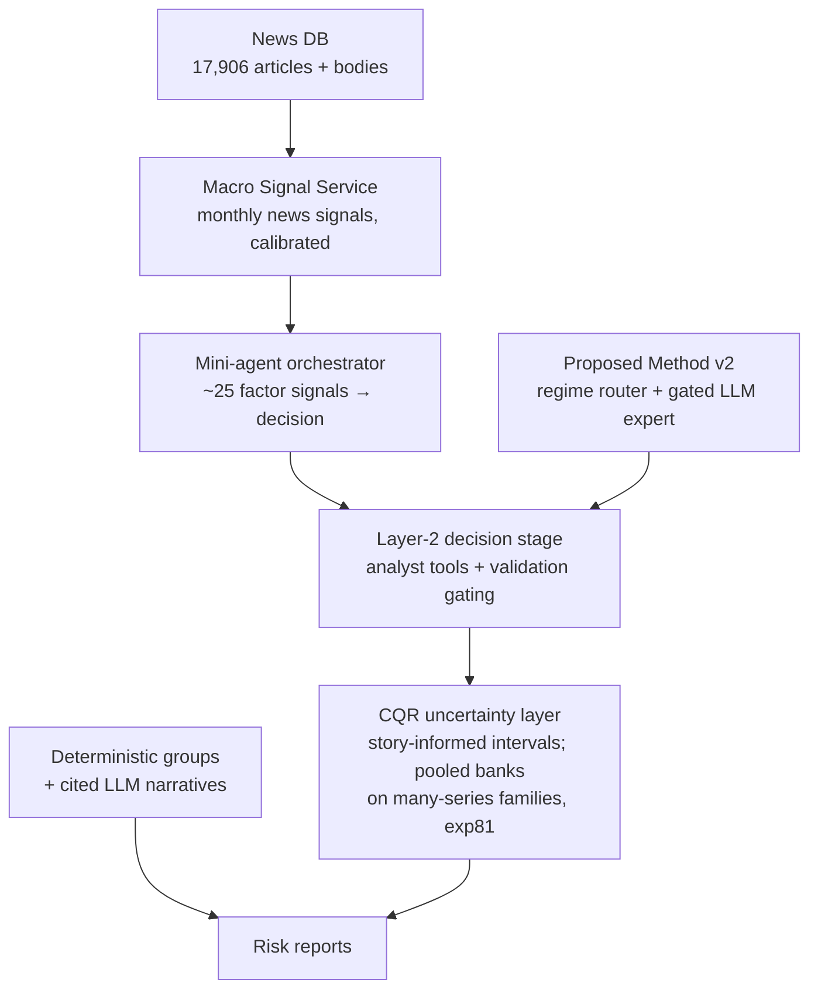

# Phase 2 Update — Since the LLM Ladder (exp63)

> **Status: CURRENT — last updated 2026-10-20**

*What was added after the classical/LLM benchmark program closed, framed
around the mortgage-attrition problem. Results marked ✅ are final and
verified on `main`. All experiments in this phase have landed (through
exp88) — nothing below is in flight.*

## The system now has four layers around Proposed Method v2

## ✅ Final results

| Result | Numbers | Where |
|---|---|---|
| Gated LLM expert (v2) on Food CPI | CRPS 0.5322 vs v1 0.9661, p=4.3e-06; gate OFF on Tourism/M3/M4 (v2 = v1) | exp64 |
| SMM + LLM | neutral, p=0.69 — LLM ties TimesFM-calibrated | exp65 |
| OSFI M4 real-data benchmark | v2 ties naive on total runoff; runoff-rate near-unforecastable at aggregate level | exp70 |
| Red-team breaking points | S1 rate shock: ~3× CRPS at 4σ for all models; Chronos-2 coverage 0.89→0.53 | exp67 |
| Layer-2 gating | uninsured harm +10.7% (p=0.030) → +0.8% (n.s.); h=3 beats v2 −6.8% (p=0.015); ships as v2's deployment wrapper on single-series targets | exp73 |
| CQR uncertainty layer | Food CPI CRPS 1.2824 vs 1.3035 (p=1.7e-04); coverage at nominal at ~1.03–1.08× width; new default UQ layer | exp74 |
| Story features predict uncertainty | story+numeric beats numeric-only (exp74 as measured: paired t=−6.92, p=2.0e-11; **exp76's PIT-corrected re-measurement: −2.8% CRPS, p=1.9e-06** — the original figure was inflated by a one-month keying offset and is retired) | exp74, corrected in exp76 |
| ACI (adaptive conformal) | conditional win on volatile subsets (p=3.6e-05) — regime-gated option | exp74 |
| Grouping for explainability | deterministic groups + citation-enforced narratives (10/10 pass); grouping cost +0.0033 CRPS on exp66c's own scoring with the exp78 fix (the published +0.009–0.016 was largely the point-mass artifact — see exp78 row below); risk reports, not forecasts | exp66c/d |
| SHAP clustering | 2× cohort recovery vs raw features (ARI 0.091 vs 0.046) | exp66e |
| Competitor spread | settled negative at aggregate level with 54 real broker months; in-sample r=−0.345, OOS +39.3% MSE (p=0.019) — regime artifact | exp71b |
| **Macro Signal Service calibration** | 7/9 anchored categories LIVE (fx corr +0.63 holdout 0.79; food holdout 0.82; labour/inflation/housing/services/wars); certainty does not calibrate; dead: basic_needs (anti-correlated), central_bank_rates (n=1, correctly silent) | exp70-MS |
| Macro-signal integration (SMM) | honest negative — degenerate router at all signal-window origins; store validates | exp71-MS |
| Macro-signal integration (Food CPI) | **honest negative, mechanism-blocked:** all 33 signal-window origins "calm", router degenerate, both experts collapse to the LLM expert → forecasts identical to ~1e-16. The hypothesis that Food CPI spans non-degenerate regimes is refuted. **Program stance: calibration question is untested, not refuted; macro signals are now uncertainty features (exp74/exp76 line), not forecast-router inputs.** Selection-on-target check passed (minus-food_prices arm equally null) | exp77 |
| Macro signals as uncertainty features, stormy window | **exp83 ✅ the exp76 question resolved:** store backfilled to 2021-01→2023-09 (174 live-7 signals, $2.88); on Food CPI shock origins the designated encoding (story + standalone inflation direction) improves the UQ layer −1.10% CRPS (bootstrap CI excl. 0) in the meta family and −0.53% in the shipped F1 h3-gated champion (best stormy config: 2.2179, cov80 0.854); quiet-window control null — exp76's S8 null was the window. Champion feature set now story + `mac_inflation` where coverage exists | exp83 |
| Integration: shifts × group forecaster | Q1 groups isolate regional shocks: NOT supported (p=0.22, oracle geography identical). Q2 fallback: working safety valve, blunt size-based trigger. Q3 **Layer-2 protects the group forecaster too** (−0.021..−0.031, p<1e-8, win 0.65–0.68, control + all shifts) | exp72 |
| Track-1 group forecaster calibration ✅ FIXED | exp72 found `v2_forecaster_fn` emitted flat point-mass quantiles (root cause: router never fitted → predict asserted → blanket except returned the tiled last value). Fixed in exp78: naive center + PIT-safe Gaussian spread. Control CRPS 0.132→0.104 (p=4.2e-45), cov80 0.075→0.714; S1@4σ −0.033 (p=1.5e-36). exp66c's grouping cost was largely this bug × window-mean scoring: +0.0164→+0.0033 (seed 42) with the fix | exp78 |
| Track-1 group forecaster center, settled | **exp79: trailing-6-mean center is the production default** — beats naive-center on SimulatorV2 control (−0.0072 CRPS, p=0.034; replicated on 3 fresh seeds, p=1.6e-05) and S1@4σ (−0.0243, p=4.7e-07) with better shock coverage (cov80 0.713 vs 0.602); exp66c grouping cost +0.0033→+0.0018. **The real fitted v2 router was evaluated and loses**: worse than the naive center on control (p=0.012) — per-series self-fit has ≤13 backtest records. It ships as an available option, not the default, with tests that make silent fallback impossible | exp79 |
| Track-1 group forecaster: ranges + fallback | **exp80:** (a) CQR conformal layer on the shipped forecaster ❌ **not the default** — conditional@0.90 hit nominal control coverage on protocol *and* fresh seeds (cov80 0.804/0.824, CRPS-neutral) and lifted S1@4σ coverage (+0.045/+0.086) but failed the pre-registered fresh-seed S1 bar (0.652 vs 0.77); the gap is structural (bank offsets bounded by the worst pre-shock miss). Available behind a flag. (b) Thin/dead fallback split ✅ **ships**: dead groups (recent n=0) now use their own trailing mean — pooled CRPS improves in every world (p≤0.008), dead-group cells −27%, pure-death cells → 0.0000 | exp80 |
| Risk classifier of record | LLM + stats only, pooled over 5 seeds beats deterministic bins (+0.0198 bin error, CI excludes zero) | exp66g |
| Pooled conformal banks (many-series UQ) | **exp81 ✅ ships, family-gated:** cross-series pooled signed-score CQR with shrinkage (n0=24) for benchmarks with ≥8 series — beats per-series CQR pooled (Δ −0.0028, p=0.0066), M4 conformal no-op → cov80 0.805, Tourism CRPS −1.0% + coverage 0.806. Few-series families keep per-series CQR (pooling harmful on OSFI in every form tested) | exp81 |
| Shift-proof conformal (bank adaptivity) | **exp85 split verdict:** (a) Chronos-2 UQ ✅ **BC-ACI / BC-CQR ship as the documented shift-regime option** (`td_one.uq.adaptive`) — fresh S1@4σ pooled cov80 0.828–0.839 at native-level CRPS, Food CPI CRPS beats CQR by 4.6–5.6% (p ≤ 7e-22); the causal bias track is what works at shift onset, not bank surgery (resets/decay add ~nothing once CQR is in place; pooled cross-h reset is a recorded dead end). (b) Group forecaster ❌ **fresh bar not cleared in 5 rounds** (best 0.658 vs 0.77; exp80's no-default-flip stands) — detectors now genuinely run on short series (length-fitted windows + CUSUM over bank signed errors), the reset wins where post-shift evidence exists (worst origin 0.09→0.57), but ~55% of the shortfall sits at origins whose banks are structurally empty of post-shift evidence | exp85 |
| Pooled router as group-forecaster center | **exp82 ❌ honest negative — default unchanged:** one v2 router fitted on backtest records pooled across all SimulatorV2 series (the exp47 recipe) loses to the shipped trailing-mean center in both worlds (control +0.0060, p=0.0052; S1@4σ +0.0131, p=1.1e-05) — exp79's starvation hypothesis rejected (pooling ~8× records doesn't close the gap; pooled ≈ per-series fit overall). Diagnosed mechanisms: expert medians anchor on full-prefix level (center bias +0.012..+0.014 vs trail −0.002) and raw-CRPS expert selection is scale-dominated (stressed-regime winner flips ETS→naive when made scale-free). Five iteration rounds (scale-free fit, shrinkage dose-response, partial pooling, combined) close but never clear the gap — best variant reaches control parity on typical cells only. Pooled forecaster ships as a tested option (`pooled_router_forecaster_fn`, incl. `normalize_crps`), not the default; Layer-2 gate over it ties the champion (abstains ~96%) | exp82 |
| Chronos-2 as segment engine | **exp86 ❌ honest negative — nothing ships:** zero-shot Chronos-2 as the group forecaster's per-segment engine loses the pre-registered member-weighted endpoint to the shipped trailing-mean device on protocol seeds (0.09024 vs 0.08849; S1 degradation worse) and ties-to-loses on fresh seeds; its unweighted protocol-seed win (−0.00526, p=0.026) was seed noise (fresh: +0.00200, p=0.357). Mechanism: Chronos wins the cells where the wrapper substitutes the smooth portfolio series and loses on short noisy own-series — its strength in this program is portfolio-level (exp67), not segment-level. exp81's pooled conformal over Chronos does replicate as a coverage repair (cov80 0.82–0.83 vs 0.76–0.77, both seed sets) at a small CRPS cost | exp86 |
| Segment scout (LLM-proposed segments) | **exp88 ✅ bar passed:** an LLM scout reading PIT-safe feature statistics + a generic policy brief and news context proposes GroupDefinition rules that recover SimulatorV2's planted cohorts at ARI 0.204/0.454/0.424 (seeds 7/42/123, mean 0.361) vs the SHAP-clustering incumbent 0.091 — the planted low_rate rule is recovered verbatim by the flash variant. Statistics alone already beat the old LLM grouper ~6×; SHAP analyst context hurts (mean 0.052) and per-cell outcome rates fail as a proposer signal (mean 0.077): segments are found by the domain prior, not outcome gradients. Scout = proposal front-end for the grouping/explainability layer; global model stays forecaster of record | exp88 |
| Manager risk reports (news-cited) | **exp87 ✅ bar passed:** the risk reporter's news-citation path runs end-to-end on real data — OSFI M4 segments + Freddie SMM, 60 segment-months, shipped forecaster + LLM+stats classifier of record flagging, PIT-safe semantic retrieval + macro signals, citation-enforced explanations: contract pass 100%, news citations in 100% of flagged explanations, judged relevance 100% (19/20 RELEVANT, 1 PARTIAL), leakage audit clean. Retrieval lessons: density (search depth × window) feeds the reporter; driver queries must be jurisdiction-scoped (Canada queries polluted the US series until filtered) | exp87 |
| Competitor spread at loan level | **exp84 ✅ bar passed — exp71b's aggregate negative reverses at loan level:** in the Freddie SFLLD cross-section (7.32M FRM30 loans, 2021–2026Q1), origination rate minus contemporaneous PMMS predicts 24m prepayment with the same positive sign in all three eras (+0.56/+0.49/+1.06 per 100bp) and improves cross-era out-of-sample prediction (Δlog-loss +0.056 pooled, ΔAUC positive in all 6 era pairs). Robust to horizon, PMMS timing, reference choice (own-mean), and vintage fixed effects; the time-varying incentive hazard confirms the refinance mechanism. Home for the signal: loan-level attrition/SMM features — the aggregate series stays closed | exp84 |

## ✅ Honest negatives (with diagnoses in the reports)

- **Anticipatory LLM overlays** (exp69/69b/69c): fail on synthetic and real
  shocks; even the oracle arm fails — timing precision is the binding
  constraint. This diagnosis motivated the uncertainty pivot.
- **News as direct forecast context**: no gain in three tests (exp44/46 line,
  re-confirmed).
- **Uplift modelling** for cohort recovery: ARI 0.002 (exp66e).
- **Lock-in correction in Layer-2**: the lock-in level carries no in-sample
  signal on OSFI runoff (|r| ≤ 0.043); gated variants correctly stay silent
  but add nothing (exp73).
- **Counterfactual tool as classifier prompt context** (exp66g): the exp66f
  single-seed signal (+0.348) did not survive 5 seeds — B vs A delta −0.0018,
  CI covers zero; a shuffled-control arm proves the content inert. Five
  iteration rounds (prompt tuning, format, param search, guidance, control)
  converge on: the original result was seed noise. The tool remains a valid
  analyst *explanation* device.
- **Chronos-2 as the segment engine** (exp86): a zero-shot TSFM does not
  beat the tuned local group forecaster per segment at h=1 — it loses the
  member-weighted endpoint on protocol seeds and its apparent unweighted
  win was seed noise (gone on fresh seeds). It wins only where the series
  is already aggregate-smooth (portfolio scope; fallback cells): TSFM
  strength here is scale-dependent. The pooled-conformal coverage repair
  (exp81 machinery over Chronos) does replicate.

## Data assets added this phase

| Asset | Coverage |
|---|---|
| OSFI M4 balances (StatCan 10100006) | 121 months, 2016–2026, 4 segments |
| BoC posted rates (Valet) | 622 months, 1975–2026 |
| Broker discount rates (Wayback/Ratehub) | 54 months, 2022–2026 |
| News DB | 17,906 articles; 544 with full bodies; fixed-512 chunking |
| Demographic + macro news topics | 27 topics (12 demographic, 15 macro) |

## ✅ Finished since this doc was created

- **Macro Signal Service** — extraction, calibration (7/9 live), and SMM
  integration results are final; see `docs/MACRO_SIGNAL.md`.
- **exp66g** — counterfactual killed; LLM+stats is classifier of record.

## In flight

Nothing. Every experiment in this phase has landed and is in the final
results table above (latest: exp88, segment scout). The combined
final delivery is [FINAL_DELIVERY.md](FINAL_DELIVERY.md).

## Framing note (for slides/reports)

Everything in this phase is expressed in mortgage/loan terms: the target is
portfolio runoff and borrower attrition; the stress scenarios are rate
cycles, policy interventions, and regional divergence; the explainability
layer produces per-cohort risk narratives a lending team can act on.
