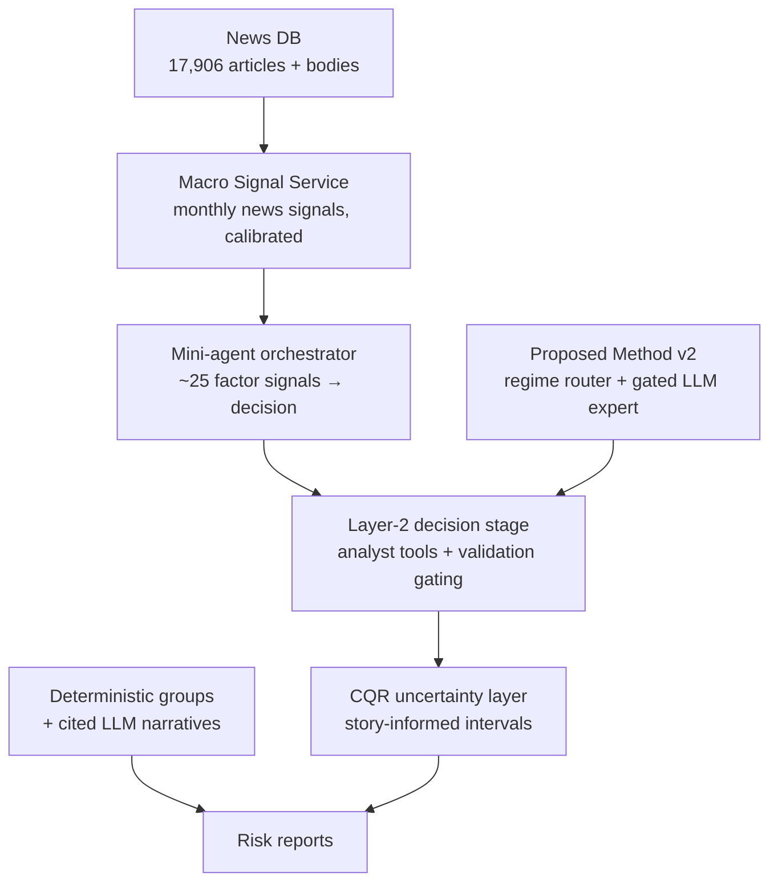

# Phase 2 Update — Since the LLM Ladder (exp63)

*What was added after the classical/LLM benchmark program closed, framed
around the mortgage-attrition problem. Results marked ✅ are final and
verified on `main`. Items marked ⏳ are experiments in flight — nothing
below closes or kills any track.*

## The system now has four layers around Proposed Method v2

## ✅ Final results

| Result | Numbers | Where |
|---|---|---|
| Gated LLM expert (v2) on Food CPI | CRPS 0.5322 vs v1 0.9661, p=4.3e-06; gate OFF on Tourism/M3/M4 (v2 = v1) | exp64 |
| SMM + LLM | neutral, p=0.69 — LLM ties TimesFM-calibrated | exp65 |
| OSFI M4 real-data benchmark | v2 ties naive on total runoff; runoff-rate near-unforecastable at aggregate level | exp70 |
| Red-team breaking points | S1 rate shock: ~3× CRPS at 4σ for all models; Chronos-2 coverage 0.89→0.53 | exp67 |
| Layer-2 gating | uninsured harm +10.7% (p=0.030) → +0.8% (n.s.); h=3 beats v2 −6.8% (p=0.015); ships as v2's deployment wrapper on single-series targets | exp73 |
| CQR uncertainty layer | Food CPI CRPS 1.2824 vs 1.3035 (p=1.7e-04); coverage at nominal at ~1.03–1.08× width; new default UQ layer | exp74 |
| Story features predict uncertainty | story+numeric beats numeric-only, paired t=−6.92, p=2.0e-11 | exp74 |
| ACI (adaptive conformal) | conditional win on volatile subsets (p=3.6e-05) — regime-gated option | exp74 |
| Grouping for explainability | deterministic groups + citation-enforced narratives (10/10 pass); cost quantified (+0.009–0.016 CRPS); risk reports, not forecasts | exp66c/d |
| SHAP clustering | 2× cohort recovery vs raw features (ARI 0.091 vs 0.046) | exp66e |
| Competitor spread | settled negative at aggregate level with 54 real broker months; in-sample r=−0.345, OOS +39.3% MSE (p=0.019) — regime artifact | exp71b |
| **Macro Signal Service calibration** | 7/9 anchored categories LIVE (fx corr +0.63 holdout 0.79; food holdout 0.82; labour/inflation/housing/services/wars); certainty does not calibrate; dead: basic_needs (anti-correlated), central_bank_rates (n=1, correctly silent) | exp70-MS |
| Macro-signal integration (SMM) | honest negative — degenerate router at all signal-window origins; store validates | exp71-MS |
| Macro-signal integration (Food CPI) | **honest negative, mechanism-blocked:** all 33 signal-window origins "calm", router degenerate, both experts collapse to the LLM expert → forecasts identical to ~1e-16. The hypothesis that Food CPI spans non-degenerate regimes is refuted. **Program stance: calibration question is untested, not refuted; macro signals are now uncertainty features (exp74/exp76 line), not forecast-router inputs.** Selection-on-target check passed (minus-food_prices arm equally null) | exp77 |
| Integration: shifts × group forecaster | Q1 groups isolate regional shocks: NOT supported (p=0.22, oracle geography identical). Q2 fallback: working safety valve, blunt size-based trigger. Q3 **Layer-2 protects the group forecaster too** (−0.021..−0.031, p<1e-8, win 0.65–0.68, control + all shifts) | exp72 |
| Track-1 group forecaster calibration ⚠️ | exp72 found `v2_forecaster_fn` emits flat point-mass quantiles (CRPS 0.165 vs 0.13 Gaussian on same histories) — Track-1 group forecasts are miscalibrated on monthly actuals; exp66b/c comparability affected (they scored window means). Fix queued, not yet shipped | exp72 |
| Risk classifier of record | LLM + stats only, pooled over 5 seeds beats deterministic bins (+0.0198 bin error, CI excludes zero) | exp66g |

## ✅ Honest negatives (with diagnoses in the reports)

- **Anticipatory LLM overlays** (exp69/69b/69c): fail on synthetic and real
  shocks; even the oracle arm fails — timing precision is the binding
  constraint. This diagnosis motivated the uncertainty pivot.
- **News as direct forecast context**: no gain in three tests (exp44/46 line,
  re-confirmed).
- **Uplift modelling** for cohort recovery: ARI 0.002 (exp66e).
- **Lock-in correction in Layer-2**: the lock-in level carries no in-sample
  signal on OSFI runoff (|r| ≤ 0.043); gated variants correctly stay silent
  but add nothing (exp73).
- **Counterfactual tool as classifier prompt context** (exp66g): the exp66f
  single-seed signal (+0.348) did not survive 5 seeds — B vs A delta −0.0018,
  CI covers zero; a shuffled-control arm proves the content inert. Five
  iteration rounds (prompt tuning, format, param search, guidance, control)
  converge on: the original result was seed noise. The tool remains a valid
  analyst *explanation* device.

## Data assets added this phase

| Asset | Coverage |
|---|---|
| OSFI M4 balances (StatCan 10100006) | 121 months, 2016–2026, 4 segments |
| BoC posted rates (Valet) | 622 months, 1975–2026 |
| Broker discount rates (Wayback/Ratehub) | 54 months, 2022–2026 |
| News DB | 17,906 articles; 544 with full bodies; fixed-512 chunking |
| Demographic + macro news topics | 27 topics (12 demographic, 15 macro) |

## ✅ Finished since this doc was created

- **Macro Signal Service** — extraction, calibration (7/9 live), and SMM
  integration results are final; see `docs/MACRO_SIGNAL.md`.
- **exp66g** — counterfactual killed; LLM+stats is classifier of record.

## ⏳ In flight (do not cite as results yet)

- **exp75** — mini-agent orchestrator (~22 factor agents + diagnostics →
  decision engine), five test beds.
- **exp76** — CQR × story fusion + UQ sweep across Tourism/M3/M4/OSFI/SMM.
  Includes the S8 ablation: macro signals as **uncertainty** features
  (story-only vs story+macro) — the program's official use of the signal
  store after exp77.

## Framing note (for slides/reports)

Everything in this phase is expressed in mortgage/loan terms: the target is
portfolio runoff and borrower attrition; the stress scenarios are rate
cycles, policy interventions, and regional divergence; the explainability
layer produces per-cohort risk narratives a lending team can act on.
