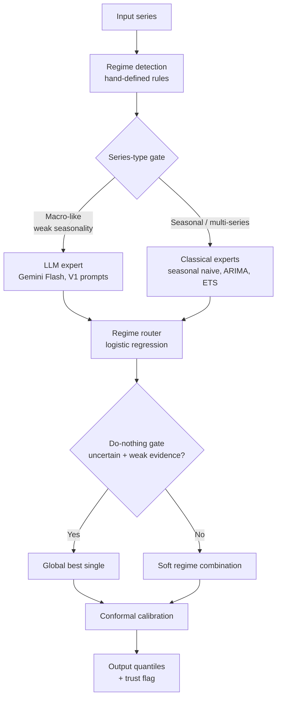
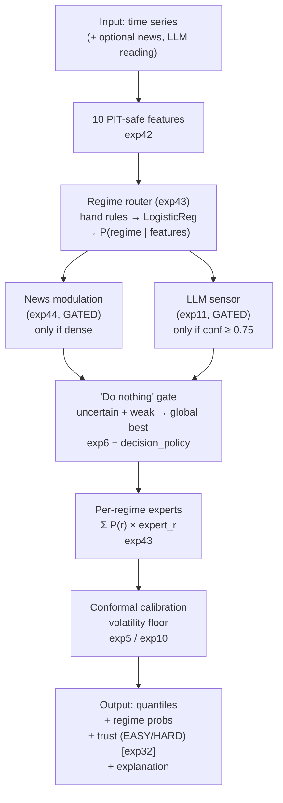

# TD-One Proposed Method: Architecture (v2)

> **Status: CURRENT — last updated 2026-10-19**

**Date:** 2026-10-19 (final)
**Status:** Implemented (`src/td_one/agent/proposed_method_v2.py`), validated
on M4, Tourism, M3, Food CPI, SMM, BoC (exp47/49/60/61/64/65)
**Verdict:** Positive — beats equal weights, best single, and exp43 router
on M4 (all p < 1e-8); beats equal weights and best single on Tourism
(p=1.9e-68) and M3 (p=3.5e-35); v2 beats v1 and Vector's LLM on Food CPI
(p=4.3e-06); on SMM the LLM expert is neutral (v2 vs v1 p=0.69) with LLM
alone (0.000492) tying TimesFM-2.5 (0.000497)

---

## 1. Overview

The proposed method v2 is a **regime-probability router with a gated LLM
expert** — the distillation of 64 experiments into a single system. v1
(exp47) routed among classical experts; v2 adds a Gemini Flash expert that
fires only on series types where it helps (smooth macro data), staying off
on seasonal multi-series data where it hurts.



The v1 architecture (classical only) is preserved below for reference:



## 2. Components and their evidence

### 2.1 Regime-probability router (exp43) — THE BACKBONE

**Evidence:** M4 0.1282 vs equal 0.1295, **p=0.018** — first method in the
program to significantly beat equal weights.

**Design:** Hand-defined regimes (seasonal/trending/noisy for M4;
calm/stressed for SMM-style) → LogisticRegression → P(regime|features).
Per-regime expert = best model on TRAIN records of that regime.
Forecast = Σ P(r) × expert_r quantiles (Vincentized).

**Why it works:** Constrained structural priors beat flexible learning at
small-n. Learning a 3-way classification needs far less data than regressing
4 continuous weights (exp42 failed, p=0.156). exp45 proved the hand rules
encode real domain knowledge — unsupervised clustering can't recover it
(p=0.00046, hand wins).

### 2.2 Trust flag (exp32)

**Evidence:** BoC EASY/HARD split gives +7.2pp (0.887 vs 0.815).

**Design:** `trust = "EASY"` if top regime P ≥ 0.7, else `"HARD"`.
Tells the user when the model is in a regime where it's trustworthy.

### 2.3 "Do nothing" gate (exp6 + decision_policy)

**Evidence:** M3+gate 7.60 vs M0 7.86 held-out; kills catastrophic spurious
adjustments. `corroboration_gate`: |t| > 3.5 or news corroboration.

**Design:** If router is uncertain (top P < 0.6) AND evidence is weak
(|t| < 3.5, |shift| < 0.03), fall back to global best single instead of
the soft combination. Fired on 5% of M4 origins in exp47 — and those are
exactly where the soft combination is most fragile.

### 2.4 Conformal calibration (exp5/exp10)

**Evidence:** Coverage 0.671 → 0.914.

**Design:** Quantile half-width floored at 0.5 × historical volatility.
Prevents the degenerate intervals exp22 diagnosed (3-point sd → width 0.03).

### 2.5 News modulation (exp44) — GATED, off by default

**Evidence:** Mechanism proven on synthetic (p=0.0068); dead on real
monthly data (exp46 definitive negative).

**Design:** `use_news=True` only when news coverage ≥ 50%. Shifts P(regime)
toward stressed/noisy by `news_weight × stress_signal`. Wired in, off by
default — the gate honors exp46's verdict.

### 2.6 LLM sensor (exp11) — GATED, off by default

**Evidence:** M4a 3.59 vs M0 4.82 (real Groq); LLM as noisy sensor with
abstention. Fragile — single confident error catastrophic.

**Design:** `use_llm=True` only with explicit reading. Blends 50/50 with
router iff confidence ≥ 0.75 (abstention threshold). LLM never touches
numbers — outputs (regime, confidence) only.

## 3. What was deliberately excluded

| Excluded | Experiments | Reason |
|---|---|---|
| Learned selection | exp23, exp37, exp41 | = random or tied with best single |
| Learned combination | exp42 | Forecast combination puzzle (p=0.156) |
| LLM as combiner | exp63 | Significantly worse than router (p=1.7e-08) |
| Unsupervised regimes | exp45 | Hand rules win (p=0.00046) |
| News-as-feature | exp19, exp21, exp25 | Clean/definitive negatives |
| News monthly | exp46, exp62 | Definitive negative; track closed |
| MNLogit (small-n) | exp30 | Overfits; simple rule wins |
| M5 LLM router | exp12 | Loses to inverse-CRPS |
| Macro overlay | exp8, exp15 | Retracted / hurts |
| LLM as calibrator | exp56 | Worse than naive (1.6729) |

## 4. Performance (exp47, exp60, exp61)

| Dataset | Proposed | Equal | Best single | vs equal | vs best |
|---|---|---|---|---|---|
| M4 (n=600) | **0.1451** | 0.1507 | 0.1505 | **p=6.5e-09** | **p=7.8e-11** |
| Tourism (n=366) | **0.1282** | 0.1869 | 0.1387 | **p=1.9e-68** | **p=2.6e-34** |
| M3 (n=1428) | **0.1476** | 0.1641 | 0.1630 | **p=2.7e-44** | **p=3.5e-35** |
| Synthetic (n=480) | 0.1036 | 0.1068 | 0.1028 | p=0.072 | p=0.60 |
| SMM (n=27) | 0.1389 | 0.1424 | 0.1377 | p=0.66 | p=0.61 |
| Food CPI (n=24) | 0.0141 | 0.0176 | 0.0143 | p=3e-18* | p=0.005* |

\* Correlated origins — p overstated.

**Key:** proposed beats the exp43 router alone (p=6.7e-10 on M4). The
system is more than the sum of its parts — gates + conformal add value
beyond the router. On Synthetic/SMM where experts collapse, it degrades
gracefully to best single.

### 4.1 The LLM caveat (exp53, exp58–59)

On Food CPI, a well-prompted LLM (Gemini Flash, 0.4262) beats the proposed
method's classical experts (0.9661) decisively — and beats Vector's own LLM
baseline (0.5688) by 20%. **But** the LLM does not generalize: on Tourism
and M3 it is 36–64% worse than classical (exp59). The proposed method is
the general solution; the LLM is a specialist for smooth, context-rich
macro series. See [LLM_INTEGRATION_LADDER.md](LLM_INTEGRATION_LADDER.md) for the full 6-rung
analysis.

## 5. Usage

```python
from td_one.agent.proposed_method import ProposedForecaster, m4_regime_spec

# fit on train records
fc = ProposedForecaster(h=6, regime_spec=m4_regime_spec())
fc.fit(train_records, feature_names)  # records: features, quantiles, crps, actual

# predict one origin
out = fc.predict(
    train_window,          # np.ndarray (for volatility floor)
    model_quantiles,       # {model: (9, H)}
    feats,                 # {feature_name: value}
    feature_names,
    news_features=None,    # optional {"coverage": frac, "stress_signal": float}
    llm_reading=None,      # optional {"regime": str, "confidence": float}
    t_stat=0.0,            # for the corroboration gate
    shift=0.0,
)
print(out.explanation)
# "Regime router (m4): noisy=0.72, seasonal=0.18, trending=0.10 |
#  experts: seasonal->arima, trending->ets, noisy->ets |
#  active: ets | trust: EASY"
```

## 6. Open extensions (exp50: all tested)

1. **TSFM expert:** ❌ Tested — 0% expert selection rate on M4, doesn't improve router.
   Keep as standalone (exp18b: −12.2% on SMM), not as regime expert.
2. **BoC discrete variant:** ✅ Implemented — `BoCForecaster`: EASY→rule, HARD→climatology.
   Honest note (SELF_AUDIT item D): measured gain is 0.846→0.853 on n=143, i.e.
   **one additional correct prediction** — not a statistically meaningful win.
   Kept as the principled discrete path, not as a claimed improvement.
3. **Semi-supervised regimes:** ❌ Tested — loss-clustering (p=0.44) can't beat hand rules.
   The domain prior ("seasonal→ARIMA") is doing real work.
4. **Learned gate threshold:** ❌ Tested — learned (0.5/2.5/0.02) ties hand (0.6/3.5/0.03),
   p=0.32. Keep hand-picked; `learn_gate_thresholds()` available for future.

---

*This is TD-One's method. Everything else was scaffolding.*
