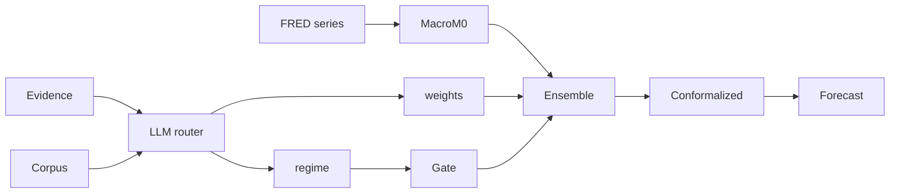

# TD-One Methodological Redesign

> **Status: HISTORICAL — point-in-time record, dated 2026-10-16. design record; current direction in PHASE2_UPDATE.md**

**Date:** 2026-10-16. **Status:** Active design — governs all future work.
**Basis:** overnight research findings (exp5–exp11, multi-seed) +
`docs/LITERATURE_SURVEY.md` (§6).

PLAN_SOLO.md remains the build record. This document is the forward
design: what we keep, what we kill, and what we try next — with the
evidence for each decision.

---

## 1. What the evidence says

| Finding | Source |
|---|---|
| Tuned classical (M0 w3, conformalized) beats real Chronos-2 / TimesFM-2.5; neither TSFM significant on any of 5 seeds — **on synthetic DGPs**. On real M4 Monthly data both TSFMs beat classical ~20% CRPS | exp5, multi-seed, exp14 (§2k) |
| ReAct LLM agent's interventions are net-negative with a real backend (M2 5.40/4.35 vs M0 0.76/1.40) | honest exp3 |
| LLM numerical deltas over-adjust; regime gate (z-test "do nothing" prior) beats M0 on held-out | exp6 |
| 70 years of judgmental-adjustment literature: routine expert adjustment *increases* errors; adjust only on strong evidence | LITERATURE_SURVEY §3 |
| Agentic literature: LLM as orchestrator/router, never number-generator; "extended deliberation may worsen calibration" | LITERATURE_SURVEY §2 |
| Raw-LLM forecasting fragile by theory (linear attention ≤ linear models on AR(p); CoT collapses to mean) | LITERATURE_SURVEY §1.2 |
| Macro structure, when present, is worth 32% CRPS (exp8, oracle); OLS estimate later retracted as DGP artifact (exp15) | exp8, exp15 |
| Current DGP likely too easy for M0 — missing burnout, 30-month seasoning, S-curve refinance incentive | LITERATURE_SURVEY §5 |
| Real M4 data flips the TSFM story: both real TSFMs beat classical ~20% CRPS; "M0 beats everything" was a synthetic-DGP artifact | exp14 (§2k) |

*Evidence record: `docs/LITERATURE_SURVEY.md` §6 (recommendations with
full rationale). This document keeps only the decisions.*

---

## 2. Design principles (going forward)

1. **The LLM never outputs numbers.** No forecasts, no deltas, no magnitudes.
   It outputs structure: weights, classes, confidences, flags, rationales.
   All numerical work stays in tested classical code.
2. **Adjustment needs evidence; magnitude needs shrinkage.** Any path that
   modifies a classical forecast must pass a statistical gate, and any
   magnitude must be shrunk. The ±0.75 bound alone is insufficient.
3. **Report the M0 envelope, not a point M0.** The window is a tuning
   parameter with seed-dependent direction. Baselines are tuned or the
   envelope is shown.
4. **5+ seeds, paired tests, for every model comparison.** The seed-2
   window flip proves single-seed claims are unreliable.
5. **Mock-backend claims about agentic skill are banned.** Agent
   evaluations run on real backends only.

---

## 3. Architecture going forward

- **Baseline:** conformalized M0 with tuned window (the default M0).
- **Classical upgrades:** macro-aware M0 (FRED features), ACI, hierarchical
  on thin segments, TSFM + exogenous FRED rematch.
- **Agentic roles (ranked by our tests, not the literature's):**
  (1) regime narrative → gate — qualified positive, first agentic win
  with real components (exp11: M4a 3.59 vs M0 4.82), but fragile;
  (2) critic/auditor flags — untested, still candidate;
  (3) ensemble router — **deprioritized**: clean negative vs
  inverse-CRPS (exp12: 2.60 vs 2.32), inverting the survey's ranking.
  Never forecaster.
- **DGP:** simulator v2 with burnout, seasoning, S-curve, offers,
  richer heterogeneity, baked-in FRED macro — a harder test that
  rewards macro-aware models.

---

## 4. Workstreams (all landed 2026-10-16)

| # | Track | Status |
|---|---|---|
| 1 | Literature survey | ✅ `docs/LITERATURE_SURVEY.md` |
| 2 | Simulator v2 (offers, burnout, seasoning, S-curve, FRED) | ✅ `src/td_one/data_gen/simulator_v2.py`, exp9 |
| 3 | Classical (conformal default, window tuning, macro_m0, ACI, thin-seg hier) | ✅ exp10, `scripts/scale_up.py` |
| 4 | Agentic redesign (regime-reader ✅ qualified positive; ensemble router ❌ clean negative) | ✅ exp11, exp12 |
| 5 | TSFM+FRED rematch | ✅ exp13 — mechanism works, headline a draw |
| 6 | Real-data benchmark (M4) | ✅ exp14 — synthetic conclusions break on real data |

Open next: Freddie Mac loan-level (needs registration — see
`docs/REAL_DATA_SURVEY.md`); LLM + news/data-store hookup
(`docs/REAL_DATA_SURVEY.md` §"Note on the LLM-context direction").

---

## 5. Kill list (do not revisit without new evidence)

- M2 as ReAct-numerical-forecaster (honest negative + theory).
- M3 default-always-adjust (invert the default; gate required).
- Prompt-engineering the forecaster to "be more careful" (CoT-collapse).
- LLM zero-shot number forecasting as a product direction.
- Bigger LLM as the fix (120B already; size ≠ forecasting skill).
- Single-seed model claims.

*Note (2026-10-16): exp14's real-data TSFM win does not revive any
killed item — it concerns TSFMs vs classical, not LLM roles. It does
reinforce the last item: exp14 is itself single-seed, so the ~20%
needs multi-seed confirmation before becoming a claim.*
