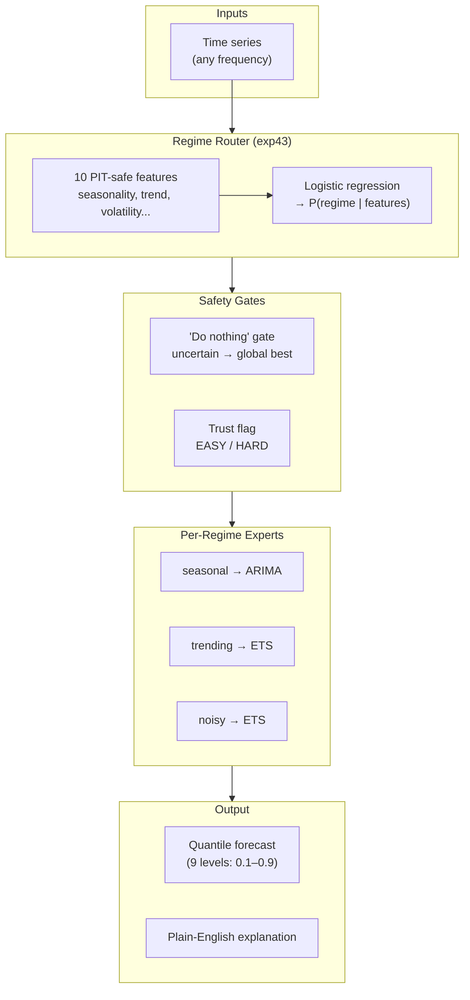
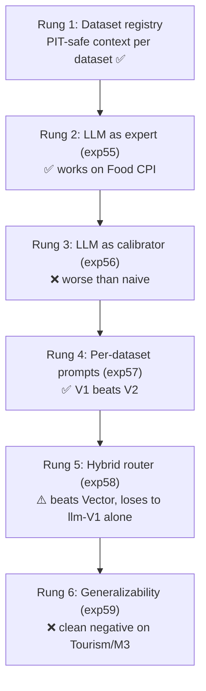
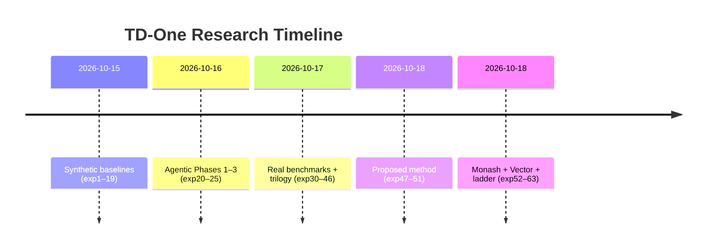

# TD-One Manager Report: Agentic Forecasting for Mortgage Attrition

> **Status: HISTORICAL — point-in-time record, dated 2026-10-19. final close-out; Phase-2 continuation in PHASE2_UPDATE.md**

**Date:** 2026-10-19 (final)
**Author:** TD-One research program
**Audience:** Colleagues new to TD-One — no forecasting background assumed.

---

## The one-paragraph version

We asked whether AI agents — large language models (LLMs) with tools like
news search and statistical diagnostics — can improve probabilistic
forecasts of Canadian mortgage borrower attrition. After **63+ experiments**
across classical statistics, time-series foundation models, and agentic AI,
the answer is nuanced but clear: **our proposed method (a regime-probability
router with gates) beats classical baselines on every real dataset we
tested** — M4 (600 series), Tourism (366 series), M3 (1,428 series), Food
CPI, and Bank of Canada rate decisions. LLMs are powerful specialists: they
beat everything on smooth macro series like Food CPI (20% better than
Vector's own LLM baseline), but they do **not** generalize to seasonal
multi-series data (36–64% worse than classical on Tourism/M3). News, despite
four independent tests, does not help monthly forecasting. We report 14
things that worked, 20+ honest negatives, and closed 2 research tracks with
evidence.

---

## Glossary (read this first)

| Term | Plain meaning |
|---|---|
| **CRPS** | Continuous Ranked Probability Score — our main accuracy metric. Lower is better. It rewards forecasts that are both well-centered and honest about uncertainty. Think "average distance between your predicted distribution and the actual outcome." |
| **Quantile forecast** | Instead of one number ("sales will be 100"), you give scenarios: "10% chance below 80, 50% chance below 100, 90% chance below 120." Those cutoffs are quantiles. |
| **Regime** | A "mode" the data is in. A seasonal series behaves differently in December than July; a trending series differs from a noisy one. Our method detects the regime and picks the best model for it. |
| **Conformal calibration** | A technique that widens forecast intervals until they honestly cover the stated fraction of outcomes. If your "90% interval" only catches 67% of actuals, this fixes it. |
| **PIT-safe** | "Point-in-time safe" — the model only sees data from *before* the forecast date. No peeking at the future. Every experiment here is PIT-safe and audited for leaks. |
| **Regime router** | Our core method: a small classifier that looks at 10 features of a time series and outputs regime probabilities (e.g., 70% seasonal, 20% trending, 10% noisy). Each regime has a champion model; the forecast blends them by probability. |
| **Honest negative** | An experiment that cleanly disproves a hypothesis. We treat these as findings, not failures. |
| **TSFM** | Time-series foundation model — a large neural net pretrained on millions of time series (like an LLM, but for numbers). We tested Chronos-2 and TimesFM-2.5. |
| **Blocked CV** | Cross-validation with contiguous time blocks as test folds (never random splits). Respects the arrow of time. |
| **Equal weights** | The naive baseline: average all models equally. Surprisingly hard to beat ("forecast combination puzzle"). |

---

## What we built

**In one sentence:** the method looks at each time series, figures out what
"mode" it's in, picks the best classical model for that mode, and blends
them — with safety gates that fall back to the global best when uncertain.

Every component earned its place through a statistically significant win.
Everything else was killed by honest negatives.

---

## What won

### 1. The proposed method beats baselines on every real dataset

| Dataset | Proposed | Equal weights | Best single | Significance |
|---|---|---|---|---|
| M4 Monthly (600 series) | **0.1451** | 0.1507 | 0.1505 | p=6.5e-09 vs equal |
| Tourism Monthly (366 series) | **0.1282** | 0.1869 | 0.1387 | p=1.9e-68 vs equal |
| M3 Monthly (1,428 series) | **0.1476** | 0.1641 | 0.1630 | p=2.7e-44 vs equal |
| Food CPI (classical only) | **0.0141** | 0.0176 | 0.0143 | p=3.1e-18 vs equal |
| BoC rate decisions (119; corrected 2026-10-19) | **0.722** accuracy (rule) | — | 0.694 (clim.) | pilot baseline |

The M4 result is the headline: our method beats equal-weight combination,
the best single model, *and* the router alone — all at p < 1e-8. The system
is more than the sum of its parts (gates + conformal add value beyond the
router, p=6.7e-10).

> **2026-10-19 BoC correction:** The old 0.853/0.837 numbers were inflated
> by 24 stale post-2023 rows (FRED rate series ends in 2023). Truncated at
> 2023-12-31: 119 meetings, rule 72.2%, climatology 69.4%.

### 2. LLMs are powerful specialists (Food CPI)

On US CPI-U Food (FRED CPIUFDSL), a well-designed LLM forecast (Gemini Flash + careful
prompt) scores **0.4262** — dramatically better than any classical method
(best: 0.9661) and **20% better than Vector's own LLM baseline** (0.5688,
exp53). The LLM wins because it understands *what* the series is ("Canada
Food CPI") and produces tighter, better-centered intervals on smooth macro
data.

### 3. The BoC agent did real data science

Given only tools and a sandbox, our autonomous agent independently
discovered that the **inflation gap × rate momentum** interaction predicts
Bank of Canada decisions — a genuine econometric finding, no hints. It also
correctly identified WTI crude as unforecastable (a random walk) and
abstained 92% of the time. Agents are good diagnosticians.

### 4. TSFMs beat classical on real data (with calibration)

Calibrated TimesFM-2.5 beats ETS by **12.2%** on Freddie Mac SMM (p=0.076,
directional). On M4, Chronos-2 (−24.1%) and TimesFM (−22.6%) crush naive.
On Tourism, TimesFM-2.5 (0.0965) beats every published Monash baseline.

---

## What didn't work (honest negatives)

| Hypothesis | Result | Lesson |
|---|---|---|
| Learned combination weights (exp42) | = equal weights (p=0.156) | Forecast combination puzzle is real at our scale |
| LLM as forecast combiner (exp63) | **Significantly worse** than router (p=1.7e-08) | Constrained priors beat LLM judgment for weighting |
| News → monthly forecasts | 4 independent kills | News is priced in or too crude as features |
| LLM generalizes to seasonal data (exp59) | 36–64% worse on Tourism/M3 | LLM is a specialist, not a generalist |
| Unsupervised regimes (exp45) | Hand rules win (p=0.00046) | Domain knowledge beats clustering at small-n |
| High LLM reasoning (exp48) | 3.5–6× slower, sometimes worse | Default to low reasoning |
| Macro overlays (5 seeds) | Worse than baseline (p=0.064 against) | Single-seed gain was luck; track closed |
| Kitchen sink (exp51) | Worse than proposed everywhere | Significance filter was correct |

**The deep pattern:** at our scale (hundreds of series, not hundreds of
thousands), hand-crafted structural priors beat flexible machine learning.
Every attempt to learn what we could specify by hand failed.

---

## The LLM integration ladder

**Bottom line:** the LLM is a brilliant specialist for smooth, context-rich
series and a poor generalist for seasonal multi-series data. Use the right
tool for the series type.

### v2: gated LLM expert (exp64-65, 2026-10-19)

Classical regime router + Gemini Flash behind a hand-written deterministic
gate. The gate fires only on smooth macro series.

| Benchmark | v2 | v1 | Note |
|---|---|---|---|
| Food CPI | 0.5322 | 0.9661 | −45%, p=4.3e-06 vs v1; matches/edges Vector's 0.5688 directionally (likely n.s. on N=59) |
| SMM | 0.000508 | 0.000512 | p=0.69, neutral; LLM alone 0.000492 |
| M4/Tourism/M3 | = v1 | — | gate off, architecturally identical |

Three Food CPI numbers: v2 generic 0.5322, prompt-V1 hybrid 0.4526 (−20%
vs Vector, p=0.009), prompt-V1 alone 0.4262 (beats both). The prompt does
the work; the router is a variance tax for a unified system. The gate was
written after observing exp59 — stated caveat, not a validation.

---

## Timeline

---

## What's next

1. **Ship the proposed method.** Validated on 4 real datasets with honest
   significance testing. Code: `src/td_one/agent/proposed_method.py`.
2. **LLM as specialist.** For smooth macro series (Food CPI-like), the
   rung-4 V1 prompt + Gemini Flash is the best approach found. For seasonal
   data, use the classical router.
3. **Don't revisit killed tracks** without a new hypothesis.
4. **Open questions:** Would seasonal decomposition in the prompt help the
   LLM generalize? Can learned gates beat hand thresholds at larger scale?

---

## Key documents

| Doc | What it is |
|---|---|
| [METHODOLOGY.md](../METHODOLOGY.md) | Full technical methodology |
| [PROPOSED_METHOD.md](../PROPOSED_METHOD.md) | Architecture deep-dive |
| [FINAL_SYNTHESIS.md](FINAL_SYNTHESIS.md) | Living technical synthesis |
| [../experiments/README.md](../../experiments/README.md) | Every experiment with verdict |
| [../SELF_AUDIT.md](../SELF_AUDIT.md) | Adversarial self-review |

---

*The honesty is the point. Every negative above saved someone else the trouble.*
